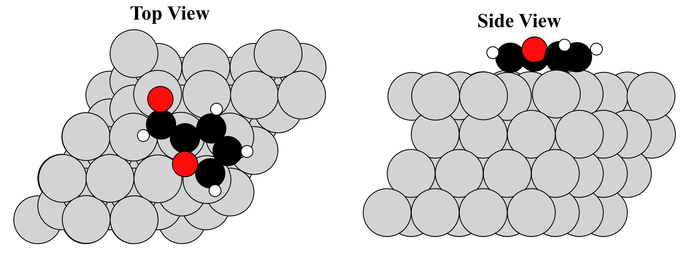
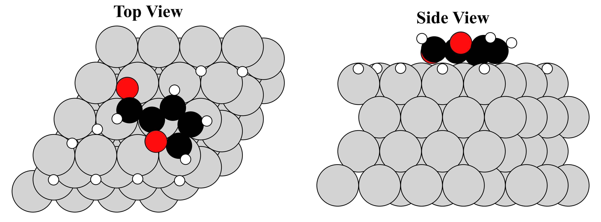

# StructurePlotting_ASE
A Python plotting utility using ASE to load VASP `POSCAR`/`CONTCAR` structures, optionally shift atomic positions, and generate top and side views of the structures.
**Version 1.2.0 (v1.2.0)** — current release.

Updates in **v1.2.0**
* Refactored main.py to organise the workflow within main() and use if __name__ == "__main__": main() for controlled execution.
* Preserved existing configuration options, defaults and functionality while preventing the workflow from running automatically when main.py is imported.
* Improved reference structure loading and error handling.
* Clarified reference compatibility requirements and shift-mode descriptions.
* Standardised structure-related error messages for general use.

# Related projects
This repository is part of a collection of ASE-based tools for visualising VASP structures and analysing Bader charge changes.
* [StructurePlotting_ASE](https://github.com/Pradders/StructurePlotting_ASE) — General visualisation of VASP structures, including top and side views, atomic shifting and optional reference-surface alignment.
* [BaderTransition_atomplot](https://github.com/Pradders/BaderTransition_atomplot) — Visualisation of Bader charge differences between initial and final structures.
* [BaderTransition_catalyst](https://github.com/Pradders/BaderTransition_catalyst) — Catalyst-specific Bader charge analysis, comparing corresponding catalyst atoms even when the total number of atoms differs between structures.

# Overview
The code can:
* Locate `CONTCAR` or `POSCAR` files.
* Load structures using ASE.
* Optionally expand the periodic cell.
* Optionally shift structures in the x and/or y directions.
* Preview structures before applying a manual shift.
* Apply either a common or individual shift in case the adsorbates extend over the unit cell x,y dimension boundaries.
* Optionally use a reference surface to provide a consistent substrate representation across different structures.
* Check that requested reference elements exist and that their atom counts match the input structures.
* Check compatibility between the structures and the reference surface.
* Replace the substrate atoms in the visual representation with the corresponding reference surface.
* Preserve the calculated positions of adsorbates and other non-reference atoms when using the reference surface.
* Colour atoms according to their elements.
* Generate top and side views.
* Save the resulting figures as `.png` files.

# Folder and file access
The files should be located in folders relative to `main.py`. The code searches for `CONTCAR` and `POSCAR` files. If both are present in the same folder, `CONTCAR` is used.

An optional reference structure can be stored in a separate folder. For example:
```text
Reference/CONTCAR
System_1/CONTCAR
System_2/CONTCAR
```

The reference folder is excluded from the structures processed for plotting. The reference folder is specified in `main.py` using:
```python
reference_folder = "Reference"
```

To disable the external reference structure:
```python
reference_folder = None
```

When an external reference structure is used, the elements belonging to the reference substrate are specified using `reference_symbols`. For example, for a pure Ni substrate:
```python
reference_symbols = ("Ni",)
```

The reference and input structures must have compatible unit cell dimensions and orientations, with the selected substrate atoms listed in the same order. If these assumptions are not satisfied, disable the external reference structure.

## Shifting
Structures can optionally be shifted in the x and y directions.

The shift is based on the **maximum covalent diameter** of the atoms in the structure. This is calculated from the largest covalent radius present in the structure:
```text
maximum diameter = 2 × maximum covalent radius
```

The user enters integer multiples of this diameter. For example:
```text
x = -1
y = +1
```

means that the entire structure is shifted:
* one maximum atomic diameter to the left in x
* one maximum atomic diameter upwards in y

# Shift modes
When the program is run, the user selects one of three shifting options:

```text
1: SAME shift for ALL structures
2: MANUAL shift for EACH structure
3: NO shift to ANY structure
```

## Mode 1 — Same shift for all structures
I.e., That same x/y shift is then applied to every structure processed by the program. Only the first structure is previewed.

## Mode 2 — Manual shift for each structure
Each structure is individually previewed and a separate x/y shift can be specified.

## Mode 3 — No shift
No translation is applied to the structures.

# Reference surface
An optional reference structure can be used to provide a consistent substrate representation across different systems. For example, when comparing several structures containing a Ni substrate, the Ni atoms in the individual calculated structures may have slightly different relaxed positions. The reference structure provides a common Ni surface for the visual representation. Please note that the reference surface is used only for visualisation. The calculated positions of adsorbates and other non-reference atoms are retained.

## Reference structure processing
When a reference structure is provided, the program:
```text
1. Loads the reference structure.
2. Checks that the reference structure is compatible with the structure being processed.
3. Determines the periodic representation of the structure that best matches the reference surface.
4. Applies the same periodic translation to the entire structure.
5. Uses the reference substrate atoms in the visual representation.
6. Retains the calculated positions of all non-reference atoms, such as H, C, or other adsorbates.
```

The adsorbate atoms are not moved onto ideal reference adsorption sites. Therefore, small deviations of atoms such as H from ideal hollow, bridge, or top sites are retained in the visual representation. This is important because the calculated adsorbate geometry may result from interactions with other adsorbates, molecules, and the relaxed substrate. Automatically moving the adsorbates to ideal reference sites would change the calculated geometry. The reference surface should therefore be regarded as a visualisation aid for consistent substrate representation, rather than as the actual relaxed substrate geometry.

Periodic alignment assumes that the required translation can be handled by shifts of −1, 0, or +1 along the first two fractional coordinates.

If the reference structure cannot be loaded, an informative error is raised instead of silently continuing without the requested reference.

# Colour coding
Atoms are coloured according to their chemical element. Specific colours can be defined in `main.py`. For example:

```python
element_colors = {
    "Ni": "lightgray",
    "C": "black"
}
```

Elements not explicitly assigned a colour use the ASE/Jmol default colours.

# Views
Two views are generated for each structure:
1. **Top View**
2. **Side View**

The top view uses:
```python
rotation="0x,0y,0z"
```

The side view uses:
```python
rotation="270x,0y,0z"
```

The figures are arranged horizontally by default.
The default figure size is:
```python
figsize = (12, 6)
```

and the default resolution is:
```python
dpi = 300
```

The titles use a font size of 24 and emboldened.

# Periodic cell expansion
Structures are loaded as one periodic unit cell:
```python
repeat = (1, 1, 1)
```

The repeat value can be changed in `main.py` if a larger periodic structure is required, such as:
```python
repeat = (2, 2, 1)
```

# Image saving
Figures are saved to the output directory specified in `main.py`.

The default output directory is:
```python
output_folder = "Figures"
```

The directory is automatically created if it does not already exist.

The program prints the output filename before saving, for example:

```text
Processing: system_1/CONTCAR
Output: Figures/system_1.png
Saved: Figures/system_1.png
```

# Inputs

## Mode selection

When the program starts, the user is asked to select a shift mode:

```text
Select shift mode:

1: SAME shift for ALL structures
2: MANUAL shift for EACH structure
3: NO shift to ANY structure

Enter mode (1/2/3):
```

The selected mode must be confirmed:

```text
Confirm mode 1? (y/n):
```

If an invalid value is entered, the program will ask again.

## Shifting inputs
For Modes 1 and 2, the program displays the structure before asking for the shift:

```text
Previewing structure.

Press Enter to close the figure...
```

The maximum covalent diameter is then displayed:

```text
Manual shift using max_radius = x.xxx Å
```

The user enters the x and y shift:

```text
Shift in x (multiples of diameter, negative = left, positive = right):
Shift in y (multiples of diameter, negative = down, positive = up):
```

The values must be integers.

# Python files
The code is separated into several files according to their purpose.

## `main.py`
Runs the overall workflow.

```python
main()
```

This file finds the structures, including the reference structure, selects the shift mode, processes each structure and calls the plotting functions.

## `inputs.py`
Contains functions for collecting user input.

```python
get_int()
choose_shift_mode()
```

## `load.py`
Contains functions for locating and loading VASP structures.

```python
find_structure()
load_atoms()
check_reference_structure()
get_reference_structure()
```

## `shift.py`
Contains functions associated with shifting and previewing structures.

```python
max_radius()
view_cleanup()
build_shift()
apply_shift()
get_structure_shift()
```

## `plotting.py`
Contains functions for assigning atomic colours and generating the final figures.

```python
get_atom_colors()
prepare_visual_structure()
plot_surface_views()
```

# Example
See examples under the "Figures" and "Systems" folders. Two example figures are provided below.


<p align="center">
  <em>Figure 1: Example figure of furfural adsorbed on Ni(111).</em>
</p>


<p align="center">
  <em>Figure 2: Example figure of furfural adsorbed on Ni(111) alongside other H atoms.</em>
</p>

# Requirements

The code requires Python and the following packages:
* ASE
* NumPy
* Matplotlib

These can be installed using:
```bash
pip install ase numpy matplotlib
```

The structures must be in a VASP-compatible `POSCAR` or `CONTCAR` format.
